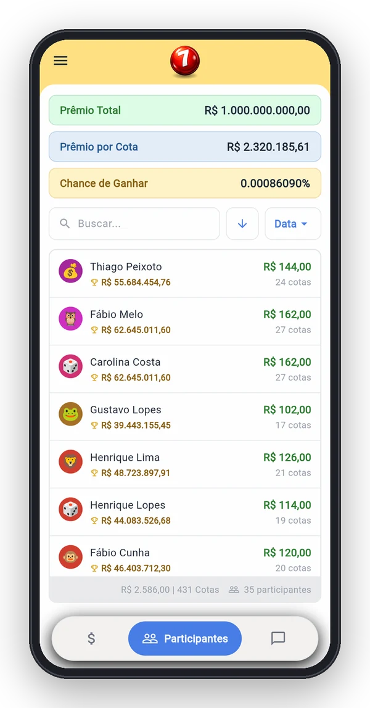
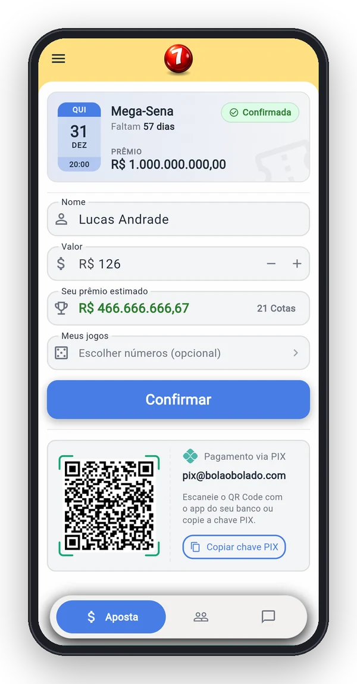
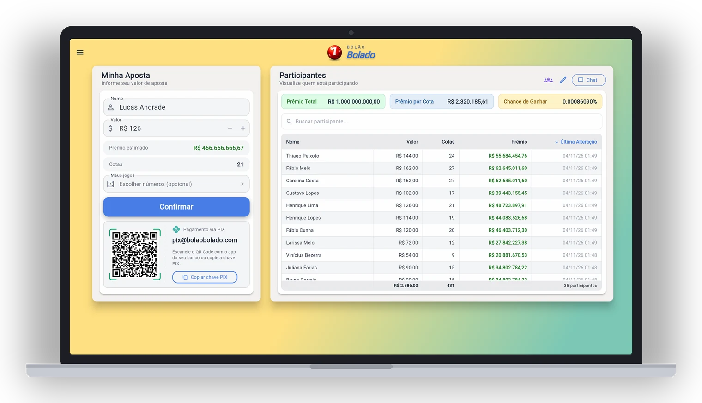
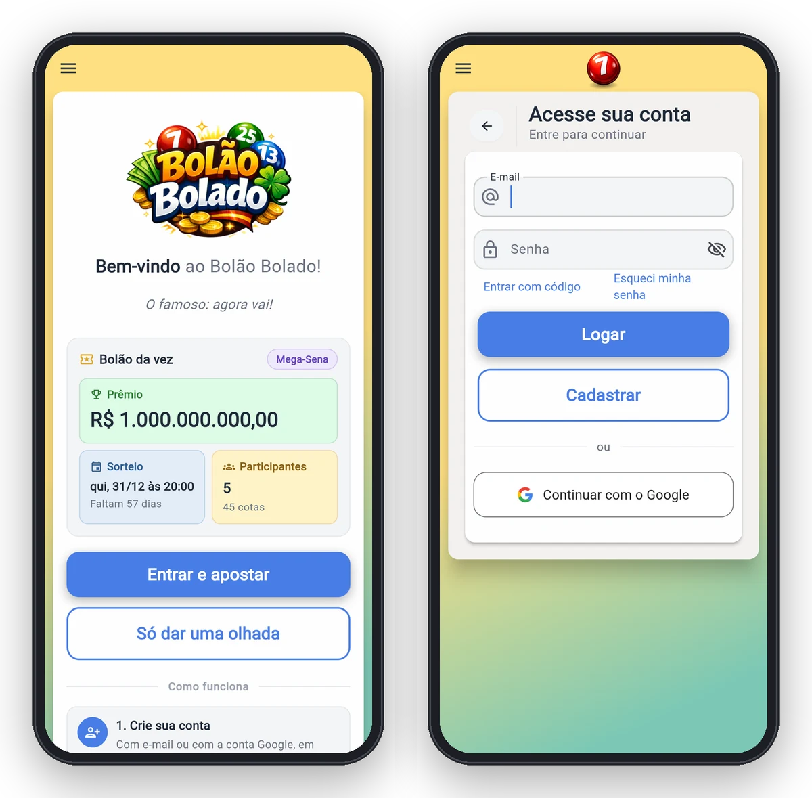

<div align="center">


# Bolão Bolado

**O bolão da turma num lugar só: quem apostou, quanto, quais jogos e o chat da galera.**

[](https://github.com/ArturoAndreatta/bolao-bolado/actions/workflows/ci.yml)


[](LICENSE)


&nbsp;&nbsp;


### [Abrir o Bolão Bolado](https://bolaobolado-app.web.app)

[Usar](#usar) · [Apostar](#apostar) · [Privacidade](#o-que-sai-do-seu-aparelho) · [Perguntas](#perguntas) · [Desenvolver](#desenvolver)

</div>

---

## O que ele faz

O Bolão Bolado organiza um bolão de loteria entre amigos. Cada um informa quanto quer apostar e, se quiser, escolhe os próprios números. O organizador confere o pagamento, e todo mundo acompanha na mesma tela quem entrou, quantas cotas cada um tem e quanto leva se o bolão ganhar.

Dois tipos de sorteio:

- **Mega-Sena:** cota de R$ 6,00
- **Lotofácil:** cota de R$ 3,50

E mais:

- **Pagamento por PIX** com QR Code e copia e cola gerados na hora, já com o valor da aposta
- **Escolha dos números**, com o custo de cada jogo calculado do mesmo jeito que a Caixa cobra
- **Chat da sala** com menções, reações e mensagem fixada
- **Painel do organizador** para confirmar apostas, lançar aposta de quem não tem conta e ajustar a sala
- **Rateio automático** do prêmio pelas cotas de cada participante
- **Entrar sem senha**, com código por e-mail ou conta Google
- **Sete temas**, entre claro, escuro e cinco temas próprios
- **Avisa quando sai versão nova** e atualiza com um toque

<p align="center">
  
</p>

## Usar

1. Abra [bolaobolado-app.web.app](https://bolaobolado-app.web.app) no navegador
2. No celular, adicione à tela de início para abrir como um app
3. Crie sua conta ou entre com o Google. Dá para ver os participantes antes de entrar

<p align="center">
  
</p>

## Apostar

1. Em **Minha aposta**, informe o valor. Ele vira cotas pelo preço do sorteio da sala
2. Se quiser, toque em **Escolher números** e monte seus jogos. Não precisa usar todas as cotas
3. Pague pelo **PIX** que aparece na tela
4. Quando o organizador confirma o pagamento, sua aposta fica verde e passa a contar no rateio

| | Mega-Sena | Lotofácil |
|---|---|---|
| Preço da cota | R$ 6,00 | R$ 3,50 |
| Jogo simples | 6 números | 15 números |
| Jogo maior | 7 números = 7 cotas | 16 números = 16 cotas |

Mudou a aposta depois de confirmada? Ela ganha a marca de alterada para o organizador conferir de novo.

## O que sai do seu aparelho

- **Conta:** e-mail e senha ficam no Firebase Authentication, do Google. O e-mail nunca aparece para os outros participantes
- **Aposta:** nome, valor, jogos e a hora ficam no Cloud Firestore e são vistos por quem está na sala
- **Chat:** as mensagens ficam salvas na sala, visíveis para os participantes
- **Perfil:** só nome, cor e emoji do avatar, que aparecem para todos
- **Esqueci a senha:** o e-mail de redefinição sai por um serviço próprio na Vercel, que só recebe o seu endereço
- **PIX:** o código é montado no próprio aparelho. O app não toca no seu dinheiro nem vê dados do seu banco

Não há anúncio nem rastreamento de uso.

## Perguntas

<details>
<summary><b>Preciso de conta para ver o bolão?</b></summary>

Não. A lista de participantes abre sem login. Para apostar e usar o chat, sim.
</details>

<details>
<summary><b>Paguei e minha aposta continua pendente</b></summary>

Quem confirma é o organizador, depois de ver o PIX cair. Avise pelo chat da sala.
</details>

<details>
<summary><b>Posso apostar sem escolher números?</b></summary>

Sim. Escolher números é opcional: suas cotas contam do mesmo jeito no rateio.
</details>

<details>
<summary><b>Como instalo no celular?</b></summary>

No Android, pelo Chrome: menu, **Adicionar à tela inicial**. No iPhone, pelo Safari: compartilhar, **Adicionar à Tela de Início**.
</details>

<details>
<summary><b>Achei um problema</b></summary>

Abra uma [issue](https://github.com/ArturoAndreatta/bolao-bolado/issues) contando o que aconteceu.
</details>

## Como funciona

1. **Abertura.** O app entra com uma sessão anônima, que já basta para ver a sala principal e os participantes
2. **Aposta.** Ao apostar, a aposta é gravada com o seu usuário e a hora do servidor. As regras do banco recusam valor ou jogos fora do permitido
3. **Conferência.** Só o organizador marca a aposta como paga, e só aposta paga entra no rateio
4. **Ao vivo.** Lista, totais e chat atualizam sozinhos em todos os aparelhos abertos

### Por dentro

- App em Flutter, publicado na web pelo Firebase Hosting e pronto para Android, iOS e desktop
- Firebase Authentication para login e Cloud Firestore para salas, apostas e chat, com cache local para abrir rápido
- Regras de segurança em `firestore.rules`: ninguém confirma a própria aposta nem altera a sala principal
- E-mail de redefinição de senha por uma API em Node na Vercel (`email_api/`)

## Desenvolver

Precisa do [Flutter](https://docs.flutter.dev/get-started/install) e do [Firebase CLI](https://firebase.google.com/docs/cli).

```powershell
flutter pub get
flutter test
flutter run -d chrome
```

Para entrar sozinho com uma conta de teste ao rodar em debug, copie `dev.env.json.example` para `dev.env.json`, preencha e rode com `--dart-define-from-file=dev.env.json`.

| Pasta | O que tem |
|---|---|
| `lib/pages` | Telas: entrada, participantes, aposta, salas e painel do organizador |
| `lib/services` | Regras de aposta, cotas, PIX, chat e login |
| `lib/core` | Temas, responsividade e o aviso de versão nova |
| `test` | Testes do cálculo de cotas, prêmios e jogos |
| `tool` | Script de deploy e enxugamento do build web |
| `web` | Página de entrada, splash e service worker |
| `email_api` | Cópia da API de e-mail que roda na Vercel |
| `.github/workflows` | CI em todo push: formatação, análise e testes |

**Publicar:** `dart run tool/deploy.dart` confere análise e testes, gera o build web e publica no Firebase.

Sugestões e PRs são bem-vindos.

---

<div align="center">

Feito por [Arturo Andreatta](https://github.com/ArturoAndreatta) · [MIT](LICENSE)

</div>
